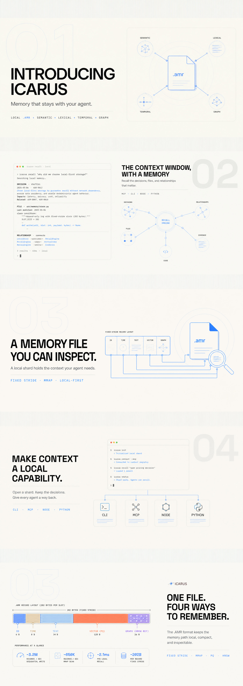

<h1 align="center">ICARUS</h1>

<p align="center">
  <strong>The memory filesystem for AI agents.</strong><br />
  One durable, memory-mapped file per tenant. Rich recall without running another service.
</p>

<p align="center">
  <a href="https://github.com/amar3012005/ICARUS/releases/latest"></a>
  <a href="./LICENSE"></a>
  
  
</p>

<p align="center">
  <a href="https://icarus.singulancelabs.com">Website</a> ·
  <a href="https://github.com/amar3012005/ICARUS#start-here">Start here</a> ·
  <a href="https://github.com/amar3012005/ICARUS#the-case-for-a-memory-file">Why ICARUS</a> ·
  <a href="https://github.com/amar3012005/ICARUS#what-happens-on-recall">Recall</a> ·
  <a href="https://github.com/amar3012005/ICARUS#use-it-from-your-agent">Agent CLI</a> ·
  <a href="https://github.com/amar3012005/ICARUS#technical-reference">Reference</a> ·
  <a href="docs/HARNESS_QUICKSTART.md">Harness quickstart</a> ·
  <a href="docs/ADAPTER_CERTIFICATION.md">Harness adapters</a> ·
  <a href="docs/TELEMETRY.md">Privacy-preserving telemetry</a>
</p>



---

## One flagship, optional modules

ICARUS is the community and documentation entrypoint. Choose the capabilities you need;
installing memory never opts a repository into governance or starts another service.

| Module | Status | Source / entrypoint | Account |
| --- | --- | --- | --- |
| Memory | Default | `crate/`, `crate/mneme-node/`; `icarus mcp install codex` | None for local use |
| Harness | Explicit opt-in | `crate/icarus-harness/`; `icarus mcp install codex --harness` | None for local use |
| Agent Bus | Experimental, proposed bridge not shipped | Separate private source; [integration contract](docs/AGENT_BUS_INTEGRATION.md) | No public installer |
| Computer Use | Experimental, separate evaluation | [HIVEMIND-Computer-use](https://github.com/amar3012005/HIVEMIND-Computer-use) | External provider requirements apply |

Optional source checkouts live under `modules/`; inspect them with `python3 scripts/modules.py status`.
See [local source setup](modules/README.md) and [module ownership and boundaries](docs/MODULES.md). Modules keep independent dependencies,
artifacts and install paths. Runtime-Runner remains a separate product repository.

Optional `icarus connect` signs in to a **SINGULANCE developer account** using the existing
HIVEMIND email/Google identity service and returns to your terminal. Developer identity needs no
purchase or company workspace and does not grant customer tenant access. Local memory stays
usable offline. Email and Google browser-to-terminal sign-in are live in CLI v0.3.91;
see [authentication and verification](docs/DEVELOPER_AUTH.md).

## The case for a memory file

Most vector databases are designed for document search. Agent memory has a different shape: a
question may need semantic similarity, exact terms, historical validity, and relationship hops at
once. ICARUS keeps that path inside a tenant-owned `.amr` shard instead of spreading it across a
vector service, a relational store, and a graph database.

> **The idea:** make context a local capability. Open a shard, write memories, ask for the right
> context, and keep working—without a server, an account, or a network hop in the critical path.

<table>
  <tr>
    <td width="33%" align="center"><strong>ONE SHARD</strong><br /><sub>A durable per-org memory file and its sidecars.</sub></td>
    <td width="33%" align="center"><strong>FOUR SIGNALS</strong><br /><sub>Semantic · lexical · temporal · graph.</sub></td>
    <td width="33%" align="center"><strong>ZERO SERVICES</strong><br /><sub>Memory-mapped, local-first, ready for an agent loop.</sub></td>
  </tr>
</table>

## Start here

### 01 — Install the agent CLI

CLI **v0.3.91** is available as one self-contained binary on macOS Apple Silicon/Intel, Linux
x64/ARM64, and native Windows x64. No Node.js or Rust toolchain is needed on those platforms.

**macOS / Linux / WSL:**

```bash
curl -fsSL https://raw.githubusercontent.com/amar3012005/ICARUS/main/install.sh | bash
```

**Native Windows PowerShell:**

```powershell
irm https://raw.githubusercontent.com/amar3012005/ICARUS/main/install.ps1 | iex
```

The POSIX installer guides you through optional setup. The Windows installer installs the binary;
run `icarus setup` afterward for guided setup. Open a new terminal after installation, or on macOS/Linux
make the command available in your current terminal with:

```bash
export PATH="$HOME/.icarus/bin:$PATH"
icarus --version
```

The POSIX installer asks which product lane to start with:

1. **ICARUS V2 — Agent Memory** (default): local `.amr` storage, lexical/BM25 recall, and
   optional MCP integration. It needs no account, LLM, embedding key, or always-running service.
2. **ICARUS V2 + Knowledge Space** (preview): reserved for a locally supervised document
   extraction and embedding sidecar. The public installer currently keeps this in honest lexical
   mode until it can provision and health-check both sidecars; it does not pretend a local model
   was installed.
3. **ICARUS V2 + Harness**: adds explicit, repository-bound governance setup for high-risk work.
   It is never implied by installing MCP memory tools.

For non-interactive installs, set `ICARUS_INSTALL_PROFILE=memory`, `knowledge`, or `harness`
before the command. Selecting `harness` still requires an explicit repository command later;
that prevents a curl installer from attaching governance to the wrong directory.

### Verify a downloaded release

`/update` validates the release checksum before replacing its executable. For a manual download,
verify both the checksum and the build provenance (available for v0.3.60 and later):

```bash
shasum -a 256 -c icarus-darwin-arm64.sha256
gh attestation verify ./icarus-darwin-arm64 -R amar3012005/ICARUS
# Verify the signed SPDX SBOM predicate for the same binary.
gh attestation verify ./icarus-darwin-arm64 -R amar3012005/ICARUS \
  --predicate-type https://spdx.dev/Document/v2.3
```

```bash
# Optional: register ICARUS as a memory MCP server for a coding agent and this repository.
# This creates the repo-local memory shard; it does not turn on harness governance.
icarus mcp install codex
```

For high-risk repository work only, opt the current repository into harness governance:

```bash
icarus mcp install codex --harness
```

### 02 — Try local memory

Save a fact and recall it. No account, API key, embedding provider, or daemon setup is required.

```bash
icarus save "The release checklist lives in docs/release.md" --org first-memory
icarus recall "release checklist" --org first-memory
icarus status
```

### 03 — Optional developer sign-in

```bash
icarus connect
```

Choose email or Google in the **ICARUS developer account** browser page. For email, enter the
six-digit code from the ICARUS email; then choose **Verify and continue**. The browser returns to
the waiting terminal, which confirms sign-in. Keep that terminal open; it waits up to fifteen
minutes. If it expires after the browser verified you, run `icarus connect` again to finish using
that browser session.

This signs in to developer identity only. It requires no purchase or company workspace, grants
no hosted customer API access, and does not upload your memory. You can skip it and keep using
local memory offline. `icarus connect --logout` removes the local developer credential.

### Upgrade an existing installation

```bash
icarus update --check
icarus update
```

Restart coding-agent sessions after an update so their MCP process uses the new binary. The
standalone CLI and the `singulance-amr` npm engine have independent releases; the npm package is
an integration library, not the v0.3.91 CLI installer.

## The performance profile

Real `bge-m3` embeddings compared with Qdrant 1.18.2. Every number has a reproduction path—see
[`BENCHMARKS.md`](./BENCHMARKS.md) for machine details, methodology, and limitations.

| Benchmark @ 1M vectors | ICARUS | Qdrant |
|:--|--:|--:|
| Recall latency, top 10 | **1.33 ms** | 2.06 ms via REST |
| Recall quality, recall@5 vs exact | **1.00** | 1.00 |
| Bi-temporal + two graph hops | **1.93 ms** | Multiple calls |
| Storage per memory | **~600 B** | ~4,500 B |
| Vector compression | **32× PQ** | 4× int8 |
| Operational footprint | **one file** | Cluster |

## What happens on recall

```text
your question
     │
     ├── semantic candidates     HNSW / product quantization
     ├── lexical evidence        native BM25
     ├── time constraints        bi-temporal filters
     └── relationship context    two-hop adjacency traversal
                                  │
                                  ▼
                         exact f32 rescore
                                  │
                                  ▼
                          context for your agent
```

The engine keeps the pieces needed for that path in the same mapped shard: fixed-width records,
compressed vectors, LZ4 text, HNSW state, product-quantization codebooks, and graph adjacency.
See [`SPEC.md`](./SPEC.md) for the frozen format and [`THESIS.md`](./THESIS.md) for the design.

## Use it from your agent

The CLI makes a local memory system available to a coding agent immediately.

```bash
# Build an org's local knowledge from a directory.
icarus ingest ./project --org acme

# Find context for an agent task.
icarus recall "Where is authentication decided?" --org acme

# Keep the shard compact and inspect its state.
icarus compact --org acme
icarus status
```

<details>
<summary><strong>What the CLI can do</strong></summary>

| Command | Purpose |
|:--|:--|
| `icarus ingest <dir> --org <name>` | Extract, embed, and store text, Markdown, JSON, CSV, and log files. |
| `icarus recall "<question>" --org <name>` | Run ranked local recall. |
| `icarus mcp install` | Register the MCP server with available coding-agent clients. |
| `icarus compact --org <name>` | Reclaim storage from deleted memories. |
| `icarus status` | Show local shard state. |

</details>

## Govern a coding task

For repository-scale coding work, ICARUS can run as a deterministic harness around an installed
coding agent: immutable contracts, bounded local context, isolated worktrees, executed verification
receipts, and a seal gate. It does not call an LLM itself or turn an agent claim into proof.

```bash
icarus harness init --agent claude
icarus task start --objective "Add scoped authentication" --contract contract.json
icarus context build --task TASK-… --budget 20000 --format markdown
icarus run --task TASK-… --agent claude
```

Read the [Harness quickstart](docs/HARNESS_QUICKSTART.md) before using a managed task, and the
[adapter certification matrix](docs/ADAPTER_CERTIFICATION.md) for the exact current guarantees.
Run `icarus mcp install <claude|codex|cursor>` from a repository root to register durable local
memory for that agent and create a stable repository org. It never requires a harness for normal
coding work. Opt in to governance only when it is warranted with
`icarus mcp install <claude|codex|cursor> --harness`.

## Use it from Node

```js
const { MnemeVectorStore } = require('singulance-amr');

const store = new MnemeVectorStore({ dataRoot: '~/.icarus/data', dim: 1024 });
await store.upsert('org_acme', [
  { id: 'm1', vector: embed('user prefers dark mode'), payload: { kind: 'preference' } },
]);

const hits = await store.search('org_acme', embed('ui settings'), 5);
// [{ id, score, payload }]
```

ICARUS is a drop-in for the vector layer in Qdrant-style agent stacks. For direct access to the
engine, open a `MnemeStore`, insert a vector, then call `recall`:

```js
const { MnemeStore } = require('singulance-amr');

const shard = MnemeStore.open('~/.icarus/data', 'org_acme', 1024);
shard.insert('user prefers dark mode', new Float32Array(vec), Date.now() * 1e6);
shard.enableHnsw();
const hits = shard.recall(new Float32Array(queryVec), 5);
```

## Use it from Python

The Python binding uses the same Rust core and on-disk format—not a second implementation.

```bash
git clone https://github.com/amar3012005/ICARUS
cd ICARUS/crate/mneme-python
pip install maturin && maturin develop --release
```

```python
from mneme_python import MnemeStore

store = MnemeStore("/path/to/data", "org_acme", dim=1024)
store.insert("user prefers dark mode", embed("user prefers dark mode"), valid_from=0)
hits = store.recall(embed("ui settings"), top_k=5)
```

For the supported Python source build, see the
[Python guide](./crate/mneme-python/README.md#install).

## Technical reference

<table>
  <tr><th align="left">Layer</th><th align="left">What it owns</th></tr>
  <tr><td><code>mseg-format</code></td><td>The byte-accurate, spec-locked `.amr` layout.</td></tr>
  <tr><td><code>mseg</code></td><td>Segments, CRUD, compaction, HNSW overlay, and shard lifecycle.</td></tr>
  <tr><td><code>mnsw-index</code></td><td>Thin usearch HNSW wrapper.</td></tr>
  <tr><td><code>mpq</code></td><td>Product quantization, ADC, and drift controls.</td></tr>
  <tr><td><code>mneme-bm25</code></td><td>Shared native BM25 scoring for Node and Python.</td></tr>
  <tr><td><code>mneme-node</code></td><td>N-API binding, CLI, MCP server, and Node vector store.</td></tr>
  <tr><td><code>mneme-python</code></td><td>PyO3 binding plus LangChain and LlamaIndex integrations.</td></tr>
</table>

<details>
<summary><strong>Native lexical search</strong></summary>

ICARUS’s lexical layer is real document-frequency/IDF BM25, shared by both bindings—not a
substring heuristic.

```js
const hits = store.bm25Search('warranty terms', 10);
```

```python
hits = store.bm25_search("warranty terms", top_k=10)
```

Tokenization is language-neutral: lowercase plus a Unicode-alphanumeric split, with no stemming
or stopword list.

</details>

<details>
<summary><strong>Build and verify from source</strong></summary>

```bash
cd crate
cargo test --workspace
cargo clippy --workspace --all-targets -- -D warnings
bash ../bench/run_p1.sh
```

`cargo test --workspace` runs the Rust workspace suites. The Python extension has its own test
instructions in [`crate/mneme-python/README.md`](./crate/mneme-python/README.md).

</details>

---

<p align="center">
  <strong>ICARUS</strong> · local memory infrastructure for agents<br />
  <sub>Built in Rust · exposed through Node, Python, CLI, and MCP · licensed Apache-2.0</sub>
</p>
